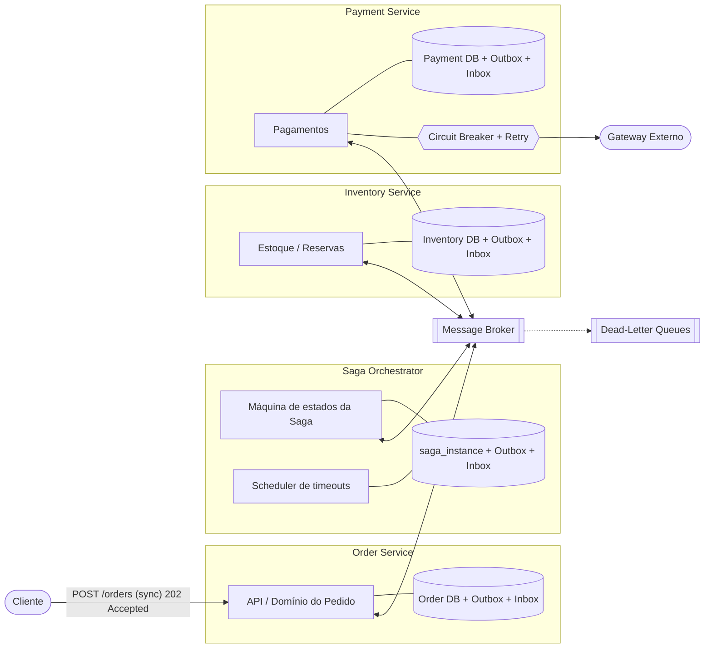
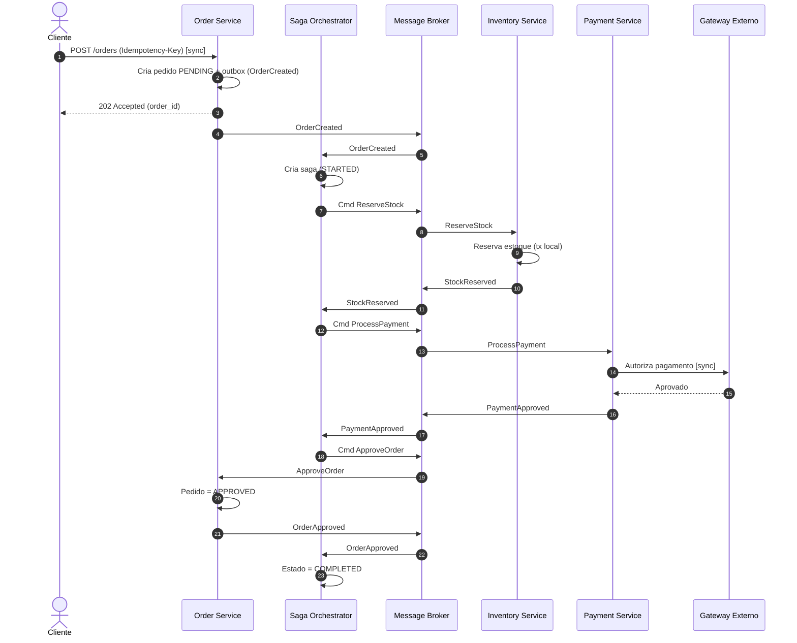
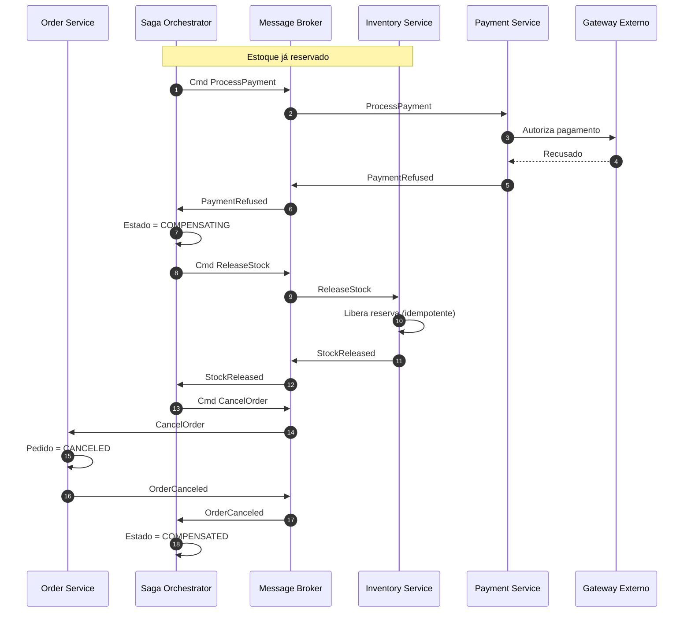

# Padrão Saga em um E-commerce: Order, Inventory e Payment

Blueprint de arquitetura para o fluxo crítico de compra de um e-commerce que migra de um monólito para microsserviços. Não há código de aplicação: o foco é o desenho, os contratos e o comportamento em caso de sucesso e de falha.

## 1. Contexto de negócio

Três domínios desacoplados, cada um com sua base de dados:

| Serviço | Responsabilidade |
|---|---|
| **Order Service** | Registra e gerencia o ciclo de vida do pedido |
| **Inventory Service** | Gerencia estoque e reservas temporárias |
| **Payment Service** | Processa pagamentos com gateways externos |

Sem transações ACID distribuídas, a consistência é **eventual**, garantida por uma **Saga**: cada etapa é uma transação local, e uma falha tardia dispara **transações compensatórias** que desfazem as etapas anteriores.

## 2. Decisão: Saga por Orquestração

| Critério | Orquestração | Coreografia | Impacto aqui |
|---|---|---|---|
| Acoplamento | Serviços conhecem só comandos e respostas | Cada serviço assina eventos de outros | Evita dependências cíclicas |
| Complexidade | Fluxo centralizado e legível | Fluxo espalhado e difícil de rastrear | Fluxo linear de 3 etapas, com compensação em ordem inversa |
| Escalabilidade | Coordenador central (mitigável com réplicas stateless e estado persistido) | Sem coordenador | Aceitável para o volume esperado |
| Observabilidade | Estado em uma tabela consultável | Exige correlação de eventos | Pedidos "presos" são fáceis de achar |
| Evolução | Nova etapa (antifraude, frete) = novo passo no orquestrador | Exige alterar vários consumidores | O fluxo de e-commerce tende a crescer |

**Escolha:** orquestração, com um **Saga Orchestrator** dedicado, mensageria assíncrona (comandos e respostas) via broker e **Transactional Outbox** em todos os serviços. Apenas a entrada (`POST /orders`) é síncrona e responde `202 Accepted`.

**Risco assumido:** o orquestrador virar um "mini-monólito". Mitigação: ele contém só a lógica de *sequenciamento*; as regras de domínio ficam nos serviços.

## 3. Diagramas

| Arquivo | Descrição |
|---|---|
| [`saga-architecture-overview`](diagrams/saga-architecture-overview.mmd) | Serviços, bancos, outbox/inbox, broker, DLQ e gateway |
| [`sequence-success-flow`](diagrams/sequence-success-flow.mmd) | Fluxo feliz: pedido, reserva, pagamento, aprovação |
| [`sequence-compensation-flow`](diagrams/sequence-compensation-flow.mmd) | Pagamento recusado após reserva: `ReleaseStock` e `CancelOrder` |
| [`saga-state-machine`](diagrams/saga-state-machine.mmd) | Estados e transições da saga (complementar) |

Para gerar os PNGs: `./diagrams/export.sh` (requer Node.js). Os arquivos `.mmd` são o fonte editável e também renderizam direto no GitHub.

### Visão geral



### Fluxo de sucesso



### Fluxo de falha e compensação



### Transações e compensações

| Etapa | Transação principal | Compensação |
|---|---|---|
| 1. Criar pedido | `CreateOrder` (PENDING) | `CancelOrder` |
| 2. Reservar estoque | `ReserveStock` | `ReleaseStock` |
| 3. Pagamento | `ProcessPayment` | `RefundPayment` (somente se já aprovado e a saga falhar depois) |

A compensação ocorre em ordem inversa e desfaz apenas o que foi concluído.

## 4. Idempotência e timeouts (resumo)

- **Idempotent Consumer:** tabela `processed_messages (message_id, consumer)` com chave única, gravada na **mesma transação local** do efeito de negócio. Duplicatas são descartadas com ACK.
- **Tabela `saga_instance`:** guarda `state`, `current_step`, `payload`, `retry_count`, `deadline_at` e `version` (lock otimista). Um scheduler reenvia comandos de sagas com `deadline_at` vencido.
- Detalhes, cenários de falha e estratégias de resiliência: [`docs/decisoes-arquiteturais.md`](docs/decisoes-arquiteturais.md).

## 5. Estrutura do repositório

```
.
├── README.md
├── diagrams/
│   ├── saga-architecture-overview.mmd   (+ .png após export)
│   ├── sequence-success-flow.mmd        (+ .png após export)
│   ├── sequence-compensation-flow.mmd   (+ .png após export)
│   ├── saga-state-machine.mmd
│   └── export.sh
└── docs/
    └── decisoes-arquiteturais.md
```
